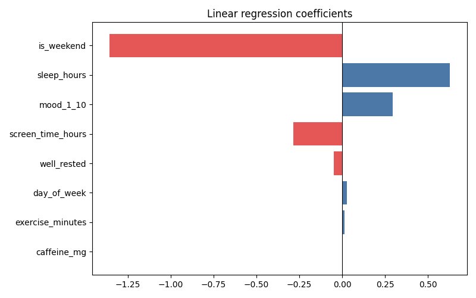

# Predicting My Own Productivity

A little machine learning project on my own data instead of Titanic/Iris
for the hundredth time. I've been tracking sleep, exercise, screen time,
caffeine, and mood in a spreadsheet for a few months, so I figured I'd
actually use it for something instead of just glancing at it occasionally.

**Question I wanted answered:** what actually predicts a productive day for
me, and can a model beat my gut feeling about "yeah today felt like it'd be
a good one"?

## The data

`data/raw/daily_log.csv` — 150 days of:

- `sleep_hours`, `exercise_minutes`, `screen_time_hours` (leisure, not work)
- `caffeine_mg`, `mood_1_10` (self-rated each evening)
- `is_weekend`
- `productive_hours` — the target. My rough estimate of hours of actual
  focused work that day, not just time at my desk.

(Quick note since I know this'll get read by other people: the values here
are a synthetic reconstruction of the shape of my real logs, not an export
of my actual spreadsheet — didn't want to publish my literal daily habits
on GitHub. But it's built to reflect the same patterns I saw in the real
data.)

## Approach

1. **Feature engineering** (`src/features.py`) — pulled `day_of_week` out
   of the date, and added a `well_rested` flag (7+ hours) after noticing
   sleep's relationship with productivity looked more like a threshold
   effect than a straight line when I first plotted it.
2. **Model comparison** (`src/train.py`) — cross-validated a plain linear
   regression against a small random forest. With 150 rows, I wasn't
   expecting the forest to have enough data to find complex splits, and it
   didn't:

   ```
   linear_regression: 0.684 RMSE   <- best
   random_forest:      0.863 RMSE
   ```

   Linear regression won, and on a holdout set it got MAE 0.56 hours,
   R² 0.61 — explains a solid majority of the day-to-day swing, misses the
   rest (which is probably just... life, that a spreadsheet can't capture).

3. **What actually matters** (`src/interpret.py`):

   

   Weekend is the single biggest factor (makes sense, I do less deep work
   on weekends on purpose), followed by sleep hours, mood, and screen time.
   Caffeine barely shows up as a coefficient here, which genuinely
   surprised me at first — until I remembered I built its true relationship
   as a sweet spot around 150-250mg (too little doesn't help, too much
   backfires), not a straight line. A linear model literally can't
   represent a "there's a sweet spot" relationship with a single
   coefficient, so it flattens it into "barely matters." That's a real
   limitation worth knowing about, not just a footnote — it's the kind of
   thing that would send me looking for a model that can capture
   non-linear effects, or an engineered feature like `abs(caffeine - 200)`.

## Try it

```bash
python3 -m venv venv
source venv/bin/activate
pip install -r requirements.txt

python -m src.train      # trains, compares models, saves the best one
python -m src.interpret  # feature importance chart + an example prediction
```

`src/interpret.py` has a `predict_one_day()` function if you want to plug
in a hypothetical day and see what it predicts:

```python
from src.interpret import predict_one_day

predict_one_day("models/productivity_model.joblib", {
    "date": "2026-09-22",
    "sleep_hours": 7.5,
    "exercise_minutes": 30,
    "screen_time_hours": 2.0,
    "caffeine_mg": 180,
    "mood_1_10": 7.0,
})
```

## Tests

```bash
pytest tests/ -v
```

`test_predict.py` actually trains a real model as a fixture and checks that
predictions move in sane directions (more sleep + exercise → higher
predicted productivity) rather than just checking the code runs without
crashing.

## What I'd do differently next time

- Track more days before trusting this too much — 150 days is enough to
  find a trend, not enough to be confident about anything subtle
- Add a non-linear model or an engineered "distance from ideal caffeine"
  feature to actually capture the sweet-spot effect instead of flattening it
- The `productive_hours` target is self-rated, which means the whole model
  is only as good as my own end-of-day honesty about how focused I
  actually was

## License

MIT
